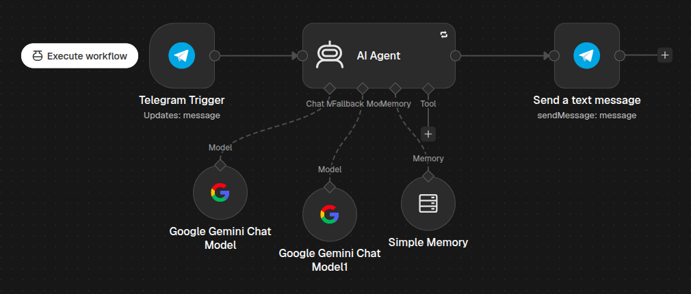
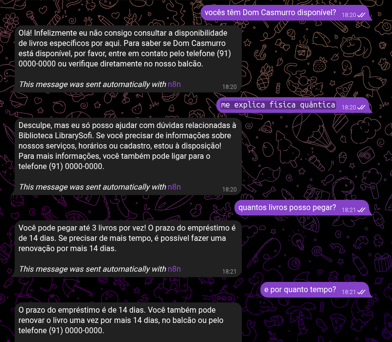
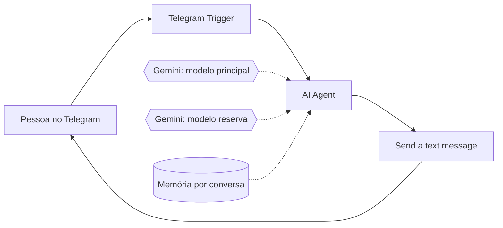

# Bot de atendimento no Telegram com n8n e IA

Um bot de Telegram que responde dúvidas de leitores de uma biblioteca: horário, cadastro, empréstimo, renovação e multa. A biblioteca (LibrarySofi) é fictícia. Montei o fluxo no n8n, sem escrever código, usando um agente de IA com o Gemini.

O que eu queria testar aqui era um atendente que responde só com as informações que recebeu e admite quando não sabe, em vez de inventar.



Na conversa abaixo ele recusa consultar o catálogo, recusa um assunto de fora e responde "e por quanto tempo?" lembrando da pergunta anterior:



## Arquitetura



A mensagem chega pelo Telegram Trigger e vai pro AI Agent, que tem as regras e as informações da biblioteca no prompt de sistema. A resposta volta pro mesmo chat pelo nó de envio.

## Estrutura

```
├── workflow.json        fluxo exportado do n8n
├── docker-compose.yml   sobe o n8n com Docker
├── .env.example         modelo das variáveis de ambiente
└── imagens/             prints do fluxo e da conversa
```

## Decisões

- O prompt de sistema traz as informações da biblioteca e manda o agente usar só elas. Se não souber, ele diz que não tem a informação e passa o telefone.
- O agente avisa que não tem acesso ao catálogo, pra não inventar que um livro está disponível.
- Cada chat tem a própria memória, separada pelo ID da conversa. Assim o bot lembra do que a pessoa acabou de perguntar sem misturar com outras conversas.
- Tem um segundo modelo configurado como reserva e nova tentativa automática, pro bot não ficar mudo se o modelo principal falhar.
- O token do Telegram e a chave do Gemini ficam nas credenciais do n8n. O `workflow.json` só guarda o nome delas.

## Como rodar

Precisa de Docker, de um bot criado no @BotFather e de uma chave da API do Gemini (Google AI Studio).

1. Copie `.env.example` para `.env` e coloque em `WEBHOOK_URL` um endereço público HTTPS que aponte pro seu n8n. O Telegram entrega as mensagens por webhook, então `localhost` sozinho não funciona.
2. Suba o n8n:
   ```bash
   docker compose up -d
   ```
3. Abra `http://localhost:5678`, crie a conta e importe o `workflow.json` (menu do workflow > Import from File).
4. Crie as duas credenciais (Telegram e Google Gemini) e selecione cada uma nos nós correspondentes.
5. Publique o workflow e mande uma mensagem pro bot.

## Limitações

As informações estão escritas direto no prompt, então mudar um horário significa editar o fluxo. A memória é a simples do n8n e se perde quando ele reinicia. O bot só entende texto: foto, áudio ou figurinha não são tratados. E ele roda no meu computador, então só responde enquanto o n8n está ligado.
